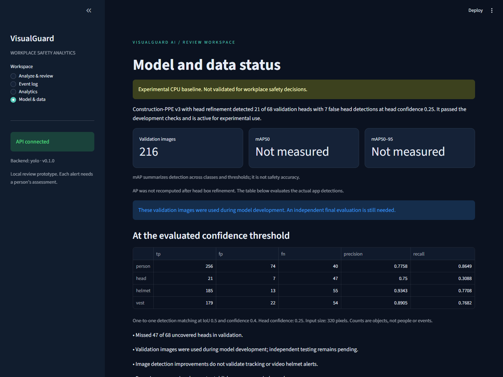

# VisualGuard AI

The locally evaluated v3 detector found 21 of 68 uncovered heads on 216 validation images, with 7 false detections (75% precision, 30.9% recall). It still missed 47 heads. Real-video accuracy remains unverified. See [head refinement results](docs/head_refinement.md). Earlier v1/v2 results below are historical.


Workplace PPE observations from images and recorded video, with person tracking, reviewable helmet alerts, and a local analytics dashboard.

This repository includes the application, synthetic workflow demo, training/evaluation scripts, and tests. Dataset files and trained weights are not distributed. A fresh clone can run the synthetic demo; real uploads require a compatible local checkpoint. Selected measured results are included in [docs/evidence](docs/evidence/README.md).



The earlier v1 checkpoint was evaluated on 211 reserved images: overall mAP50 was 66.39%, with uncovered-head recall 0/58 at confidence 0.4. These are historical v1 results, not scores for the current model. The synthetic demo remains separate from model results. See [the baseline report](docs/baseline_report.md).

The subsequent v2 experiment completed 12 additional training epochs but still detected **0/68 uncovered heads on validation at confidence 0.4**. It was rejected; v1 remained active until the subsequent v3 refinement. The dashboard includes the comparison and [model_development.md](docs/model_development.md) records the label audit, validation-only checks, and limitations. These 68 validation annotations are separate from the 58 annotations in v1's original test report.

## Run on Windows

Open PowerShell in this project directory. On a fresh clone, complete the installation below first. The original development checkout already has `.venv` installed.

```powershell
.\scripts\start.ps1
```

Open <http://127.0.0.1:8501> and select **Run synthetic demo**. Refresh the job status to see the annotated clip and timeline. The Event log page saves review decisions; Analytics separates synthetic and uploaded footage.

For actual model inference, expand **Analyze your own image or recorded video** and upload `data/demo/real-ppe-sample.jpg`. This is a traceable validation image from the acquired dataset, not an independent accuracy test. **Model & data** shows the measured class-level limitations. The local `.env` selects the experimental checkpoint; it is excluded from Git.

API documentation: <http://127.0.0.1:8000/docs>.

```powershell
# Stop only the services recorded by this project's launcher.
.\scripts\start.ps1 -Stop

# Run the full synthetic pipeline without web services.
.\.venv\Scripts\python.exe scripts/run_video.py --demo

# Checks; test temporary files remain beneath .cache/pytest.
.\.venv\Scripts\python.exe -m pytest
.\.venv\Scripts\python.exe -m ruff check .
```

For a fresh installation, use a direct Python 3.11+ executable to avoid invoking an OS install-manager shim:

```powershell
$pythonExe = 'C:\Path\To\Python311\python.exe' # Replace with your installed Python executable.
New-Item -ItemType Directory -Force .cache/tmp | Out-Null
$env:TEMP = Join-Path $PWD '.cache/tmp'
$env:TMP = $env:TEMP
$env:PIP_CACHE_DIR = Join-Path $PWD '.cache/pip'
$env:PYTHONDONTWRITEBYTECODE = '1'
& $pythonExe -m venv .venv
.\.venv\Scripts\python.exe -m pip install -e '.[dev]'
Copy-Item .env.example .env # Fresh clone only; defaults to the synthetic demo.
.\scripts\start.ps1
```

`requirements-lock.txt` records the application dependency versions. `requirements-vision-lock.txt` records the full tested Windows training environment. Install the appropriate lock before installing this package with `--no-deps`; keep pip caches and temporary files in this directory.

## What works

- Validated image uploads with synchronous analysis; recorded-video uploads return durable job IDs.
- Separate worker with atomic job claiming, heartbeats, and recovery after a 15-minute lease expiry.
- Greedy IoU person tracking, unique equipment association, conservative unknown states, and temporal event deduplication.
- Browser-playable annotated MP4, image annotations, boxes, timestamps, rule evidence, and JSON export.
- Review outcomes: pending, confirmed, false alert, or uncertain.
- Observed person-time, event rates, unknown-head fraction, and review counts.
- Dataset preparation with duplicate/proxy grouping, plus local-model training/evaluation entry points. Actual source-scene independence is not established.
- SQLite for local development. PostgreSQL Compose configuration is supplied but has not been exercised in this environment.

## Train or connect a replacement detector

1. Verify the exact dataset version's license, label definitions, and source provenance. See [data/README.md](data/README.md).
2. Prepare a scene-grouped dataset, train a detector, and evaluate on untouched held-out data.
3. Place the trusted checkpoint at `models/ppe.pt`. It must expose exactly `person`, `head`, `helmet`, `vest` names. Generic COCO weights do not qualify.
4. Install the optional stack with `.\.venv\Scripts\python.exe -m pip install -e '.[vision]'`, keeping the local cache environment variables above set. Review the applicable Ultralytics license before publishing or deploying its code or models.
5. Copy `.env.example` to `.env`, set `VG_BACKEND=yolo`, and restart the services.

The application does not download models or data during an upload. The explicit `scripts/acquire_baseline.py` command acquired the documented dataset and official base weights, recorded SHA-256 hashes, and retained the archive's license. These local assets are excluded from Git. The baseline was trained on CPU; its measured results and hardware are recorded in the baseline report.

## Decisions and limits

The four-class scheme supports **possible missing helmet**, when a visible head is detected without an associated helmet. It cannot prove vest absence or true torso visibility; missing vest detections stay **unknown**. Border crops, substantial person overlap, and ambiguous association also produce unknown helmet states. These are heuristics, not a validated occlusion model.

An event needs at least three consecutive sampled observations spanning at least 0.5 seconds. Unknown observations and gaps break the evidence run. Image observations do not create temporal events or contribute to person-time. An alert is a candidate for review, not a confirmed violation.

Person IDs are local to each clip. Crossings, camera motion, missed people, and abrupt cuts can fragment or switch IDs. Sampling uses frame index divided by reported FPS and assumes constant-frame-rate video. Audio is omitted. Very small objects and poor lighting require a real evaluation set.

Person-minutes are estimated from detected people and sampled time intervals. They include unknown observations and are not unique workers, independently measured exposure, or a safety-compliance score. Repeated uploads count again. Review labels do not automatically retrain a model.

This is a localhost prototype without authentication, retention automation, audit history, migrations, or multi-camera ingestion. Do not expose it as an internet service. Original uploads and derived media are retained under `runtime/`; manage retention explicitly before using identifiable workplace footage.

Camera-zone polygons, anomaly detection, Grad-CAM, SHAP, and a grounded VLM assistant are intentionally deferred. See [docs/architecture.md](docs/architecture.md), [docs/evaluation_plan.md](docs/evaluation_plan.md), and [docs/build_status.md](docs/build_status.md).

## Files and configuration

Runtime configuration comes from `VG_*` environment variables and the project `.env`. `configs/pipeline.yaml` documents defaults; it is not a second configuration source. All application write paths are constrained to this directory. Uploads, database, artifacts, logs, caches, and the virtual environment stay here.

The supplied Compose deployment uses the same database as the durable queue, avoiding a separate Redis service for this first version. It exposes API and dashboard ports only on localhost. Docker itself stores images and engine state outside the repository, so Compose has **not** been run under the user's project-only write constraint.

## Source references

- [Ultralytics train mode](https://docs.ultralytics.com/modes/train/) for the optional training adapter.
- [FastAPI background task guidance](https://fastapi.tiangolo.com/tutorial/background-tasks/) for separating compute-heavy video work from request handling.
- [Streamlit video API](https://docs.streamlit.io/develop/api-reference/media/st.video) for dashboard media display.
- [Ultralytics licensing](https://www.ultralytics.com/license) for the upstream licensing decision; no project license is chosen here on your behalf.

The original user-supplied proposal is preserved in `docs/project_brief.md`.
