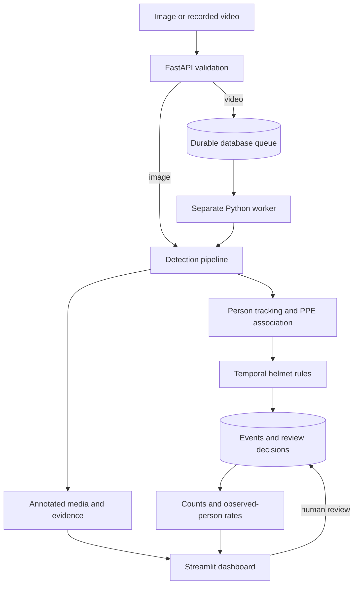

# Architecture and first-release boundaries

The default synthetic adapter recognizes exact colors in a generated clip. Real uploads are rejected unless the YOLO backend and a local checkpoint are configured. Detector names must map to the canonical four classes. The model version is chosen through the checkpoint rather than hard-coded to a YOLO release.

The tracker greedily matches person boxes by IoU with one-to-one assignments. It expires IDs after a configurable gap; it makes no re-identification claim. Equipment must lie at least 80% inside a person's expected head or torso region and match only one person. Crowded or cropped observations are unknown. Helmet evidence is still fallible even when those heuristics pass.

Temporal candidates are scoped to a tracked person. A continuous missing-helmet run is emitted once after it closes or the clip ends. The stored end time is the last supporting sample, not the next recovery frame. Confidence is the minimum supporting detection confidence, not a calibrated event probability. Evidence includes a frame timestamp and person box; the annotated clip supplies visual context.

Jobs use compare-and-update claims and random ownership tokens. Workers refresh a 15-minute lease during processing. An expired job can be retried by another worker; stale owners cannot commit a result. Each attempt gets its own output directory. Event insertion and completion are one transaction. Failed jobs remain visible; there is no automatic retry of malformed media.

Local storage uses SQLite WAL. Compose switches to PostgreSQL with the same SQLAlchemy store. This first version uses the database as the queue. Redis/Celery can replace queue polling if load measurements justify it. SQLite concurrency tests run locally; PostgreSQL/container behavior is not yet validated.

Source-relative paths and configurable storage paths are resolved and checked against the project root. Download hooks in dataset YAML are rejected. API media access is restricted to known generated artifact names. The upload file name is discarded in favor of a UUID. The service is intended for trusted local use; uploaded files still pass through third-party image/video decoders.
